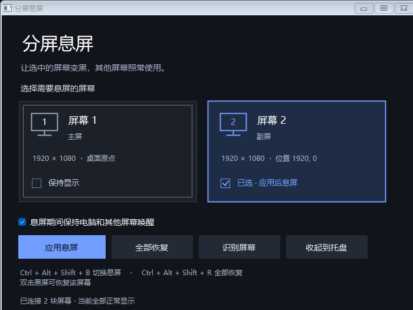

# 分屏息屏 · Screen Dimmer

让选中的显示器显示纯黑，其他显示器照常使用。显示器保持连接，桌面布局与后台程序继续运行。

轻量 Windows 桌面工具，使用 C# / WinForms 编写，无需安装、无需管理员权限。



## 下载与使用

前往 [Releases](https://github.com/yin1245/screen-dimmer/releases/latest) 下载 `ScreenDimmer.exe`，或下载包含使用说明的 `ScreenDimmer-windows.zip`。

1. 双击 `ScreenDimmer.exe`。
2. 勾选需要变黑的屏幕，点击「应用息屏」。默认选择副屏。
3. 在未息屏的显示器上继续使用电脑。

| 操作 | 快捷键或入口 |
| --- | --- |
| 切换所选屏幕的息屏状态 | `Ctrl + Alt + Shift + B` |
| 恢复全部屏幕 | `Ctrl + Alt + Shift + R` |
| 恢复某块屏幕 | 双击其黑色区域，或右键选择恢复 |
| 恢复全部屏幕 | 控制面板中的「全部恢复」；控制面板获焦时按 `Esc` |
| 识别显示器 | 「识别屏幕」会短暂显示编号 |
| 收起控制面板 | 「收起到托盘」；双击托盘图标重新打开 |

鼠标移入黑色区域不会自动恢复画面，光标在黑色区域内隐藏。关闭控制面板或从托盘菜单退出后，所有屏幕恢复显示。

## 功能

- 分别选择主屏、副屏或多块屏幕。
- 全屏纯黑遮罩，覆盖选定屏幕的桌面和任务栏。
- 在可用屏幕上显示控制面板；全部息屏时收起控制面板。
- 全局快捷键与托盘菜单。
- 可在息屏期间临时保持电脑和其他屏幕唤醒。
- 锁定电脑、插拔显示器或更改显示布局时移除遮罩。
- 重复启动打开已有控制面板。

详细行为见[使用说明](使用说明.md)。

## 从源码构建

构建环境：64 位 Windows 10 / 11，系统中的 .NET Framework 4.x 编译器与 Windows PowerShell 或 PowerShell 7。

```powershell
git clone https://github.com/yin1245/screen-dimmer.git
cd screen-dimmer
.\build.ps1 -OutputDirectory .\dist
.\dist\ScreenDimmer.exe
```

不指定 `-OutputDirectory` 时，程序输出到项目根目录。构建使用 Windows 自带的 `csc.exe`，没有 NuGet 或 npm 依赖。

推送到 `main` 或提交 Pull Request 时，GitHub Actions 自动构建并上传产物。推送 `v` 开头的版本标签时，同时创建 GitHub Release，附带 EXE 和 ZIP 下载。

## 已验证

在本地双屏 Windows 环境下，已验证主屏、副屏和双屏遮罩、目标屏幕覆盖范围、纯黑显示、全局快捷键切换与恢复、控制面板移到可用屏幕，以及退出后清除遮罩。GitHub Actions 验证构建；显示器交互需要在 Windows 桌面环境中验证。

## 限制

- 采用纯黑窗口遮罩，液晶屏背光仍亮，不等于硬件断电或省电。
- 系统锁屏、安全桌面、部分独占全屏应用和其他置顶窗口可能覆盖遮罩。
- 手动锁屏或休眠仍遵循 Windows 行为；屏幕编号按桌面位置排列，可能与 Windows 设置中的编号不同。
- 全局快捷键若被其他程序占用，控制面板会显示注册失败，可使用按钮、托盘菜单或双击黑色区域恢复。
