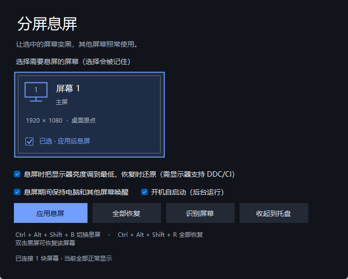

# 分屏息屏 · Screen Dimmer


让选中的显示器显示纯黑，并把它的亮度调到最低，其他显示器照常使用。显示器保持连接，桌面布局与后台程序继续运行。

轻量 Windows 桌面工具，使用 C# / WinForms 编写，无需安装、无需管理员权限。



## 下载与使用

前往 [Releases](https://github.com/yin1245/screen-dimmer/releases/latest) 下载 `ScreenDimmer.exe`，或下载包含使用说明的 `ScreenDimmer-windows.zip`。

1. 双击 `ScreenDimmer.exe`。
2. 勾选需要变黑的屏幕，点击「应用息屏」。首次使用默认选择副屏，之后记住你的选择。
3. 在未息屏的显示器上继续使用电脑。

| 操作 | 快捷键或入口 |
| --- | --- |
| 切换所选屏幕的息屏状态 | `Ctrl + Alt + Shift + B` |
| 恢复全部屏幕 | `Ctrl + Alt + Shift + R` |
| 恢复某块屏幕 | 双击其黑色区域，或右键选择恢复 |
| 恢复全部屏幕 | 控制面板中的「全部恢复」；控制面板获焦时按 `Esc` |
| 识别显示器 | 「识别屏幕」会短暂显示编号 |
| 收起控制面板 | 「收起到托盘」；双击托盘图标重新打开 |
| 命令行控制 | `ScreenDimmer.exe --toggle` / `--apply` / `--restore` |

鼠标移入黑色区域不会自动恢复画面，光标在黑色区域内隐藏。

关闭窗口或最小化后，程序收起到托盘并继续在后台运行，息屏和全局快捷键保持生效。双击托盘图标重新打开控制面板。彻底退出时，右键托盘图标选择「退出」，所有屏幕恢复显示。

勾选控制面板中的「开机自启动（后台运行）」后，每次登录 Windows 时自动启动到托盘。取消勾选即可关闭。自启动时保留所有屏幕的正常显示，通过快捷键或托盘菜单开始息屏。

也可手动运行 `ScreenDimmer.exe --background` 直接启动到托盘。

命令行参数 `--toggle`（切换）、`--apply`（息屏）、`--restore`（全部恢复）会发送给正在运行的程序；程序未运行时，`--toggle` 和 `--apply` 会先在后台启动再执行。可配合脚本、Stream Deck 或其他快捷工具使用。

## 功能

- 分别选择主屏、副屏或多块屏幕，选择按显示器硬件记住，重启或 Windows 改变屏幕编号后仍然有效。
- 全屏纯黑遮罩，覆盖选定屏幕的桌面和任务栏；不同缩放比例的多屏下按物理像素精确覆盖。
- 显示器支持 DDC/CI 时，息屏同时把亮度调到 0，黑暗环境中几乎不发光；恢复时还原原亮度，异常退出后下次启动自动还原。
- 任务栏、通知等置顶窗口浮到遮罩上方后，约 1.5 秒内重新盖住。
- 在可用屏幕上显示控制面板；全部息屏时收起控制面板。
- 全局快捷键与托盘菜单，关闭窗口或最小化后继续后台运行。
- 程序、窗口和托盘使用统一的多尺寸图标。
- 支持当前用户开机自启动，登录后直接在托盘后台运行。
- 可在息屏期间临时保持电脑和其他屏幕唤醒。
- 锁定电脑时保留遮罩并暂停保持唤醒；插拔显示器或更改显示布局后，仍连接的已选屏幕自动重新息屏。
- 重复启动打开已有控制面板。

详细行为见[使用说明](使用说明.md)。

## 从源码构建

构建环境：64 位 Windows 10 / 11，系统中的 .NET Framework 4.x 编译器与 Windows PowerShell 或 PowerShell 7。

```powershell
git clone https://github.com/yin1245/screen-dimmer.git
cd screen-dimmer
.\build.ps1 -OutputDirectory .\dist
.\dist\ScreenDimmer.exe
```

不指定 `-OutputDirectory` 时，程序输出到项目根目录。构建使用 Windows 自带的 `csc.exe`，没有 NuGet 或 npm 依赖。

图标位于 `assets/`，包含 16–256 像素的 ICO 和 PNG 预览。修改图标时可重新构建：

```powershell
$compiler = "$env:WINDIR\Microsoft.NET\Framework64\v4.0.30319\csc.exe"
New-Item -ItemType Directory -Path .\dist -Force
& $compiler /nologo /reference:System.Drawing.dll /out:dist\BuildIcon.exe tools\BuildIcon.cs
.\dist\BuildIcon.exe .\assets
```

推送到 `main` 或提交 Pull Request 时，GitHub Actions 自动构建并上传产物。推送 `v` 开头的版本标签时，同时创建 GitHub Release，附带 EXE 和 ZIP 下载。

## 已验证

1.4.0 在 HKC V2219（HDMI）上验证：息屏时亮度由 25 调到 0 并读回确认，恢复、快捷切换后还原为 25；息屏中强制结束程序，重新启动后自动还原为 25。

1.3.0 在单屏 Windows 11（100% 缩放）上验证：所选屏幕全屏纯黑（含任务栏和四角）、遮罩按物理像素对齐、任务栏被提到最前后 2 秒内重新遮住、`--toggle` / `--restore` 与重复切换、选择持久化、自启动路径自动修复、Alt + Tab 不显示遮罩。多屏与混合缩放的覆盖逻辑沿用同一路径，未在混合缩放硬件上实机验证。

在本地双屏 Windows 环境下，已验证主屏、副屏和双屏遮罩、目标屏幕覆盖范围、纯黑显示、全局快捷键切换与恢复、控制面板移到可用屏幕、关闭窗口后后台运行，以及退出后清除遮罩。自启动设置已验证启用、持久化与取消，后台启动及重复后台启动也已验证。GitHub Actions 验证构建；显示器交互需要在 Windows 桌面环境中验证。

## 限制

- 采用纯黑窗口遮罩，液晶屏背光仍亮，不等于硬件断电或省电。
- 系统锁屏、安全桌面、开始菜单和部分独占全屏应用可能覆盖遮罩。
- 手动锁屏或休眠仍遵循 Windows 行为；屏幕编号按桌面位置排列，可能与 Windows 设置中的编号不同。
- 全局快捷键若被其他程序占用，控制面板会显示注册失败，可使用按钮、托盘菜单或双击黑色区域恢复。
- 开机自启动使用当前用户的 Windows 登录启动项；更换程序文件位置后，原位置程序不存在时会在下次运行时自动指向新位置。

## 开源协议

采用 [MIT License](LICENSE)，版权归 Zhenshuai Yin 所有。
